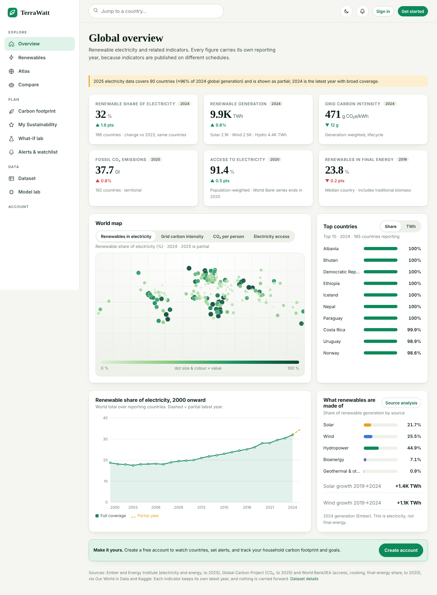
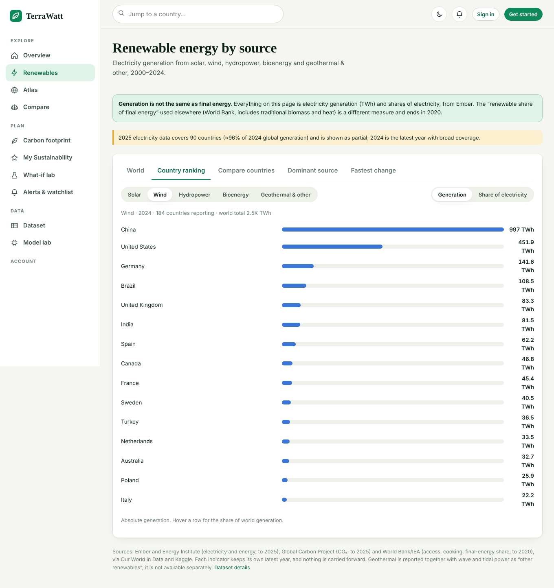
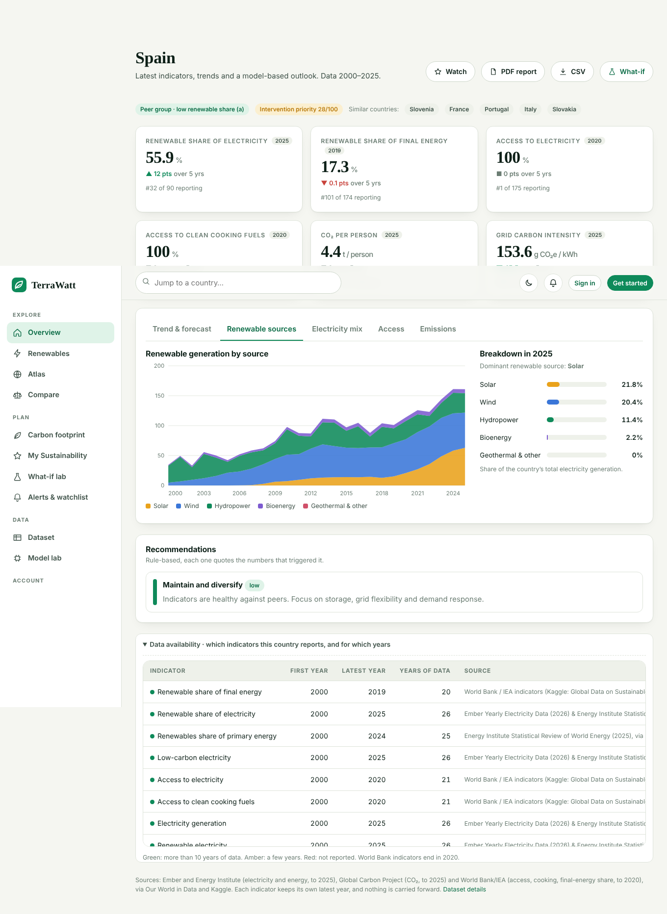
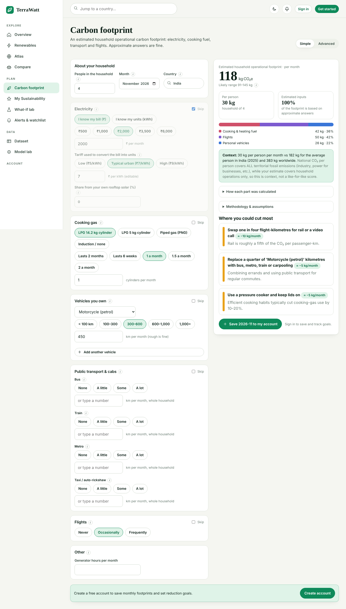
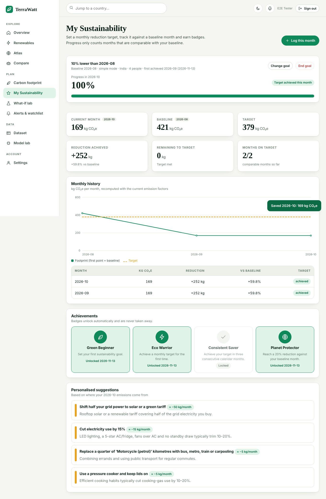
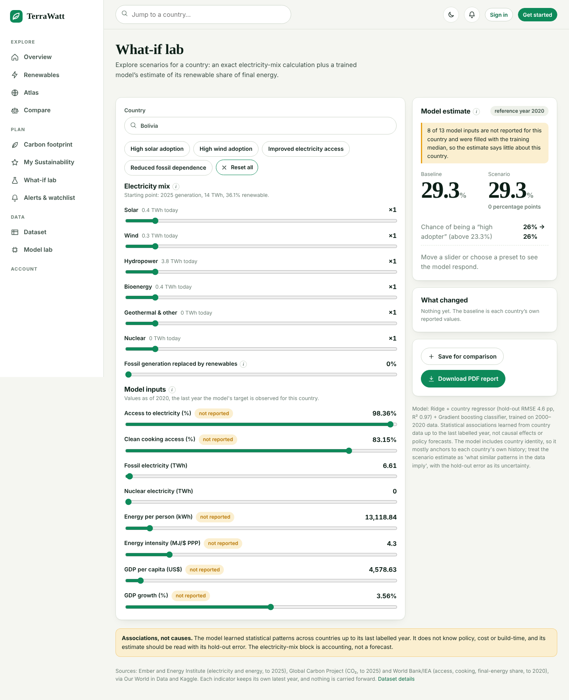
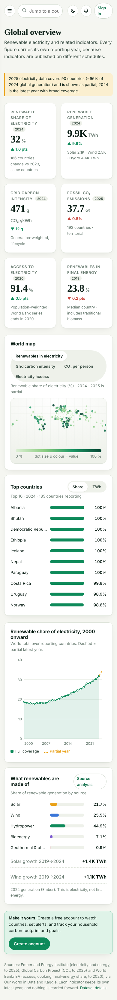
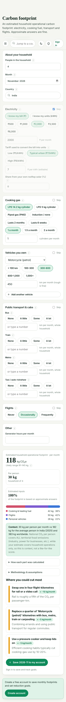
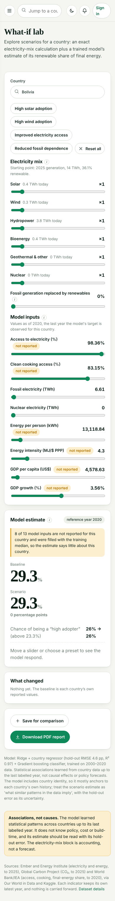

<div align="center">

# 🌿 TerraWatt

**Renewable-energy intelligence: explore 2000–2025 data for 192 countries and territories, forecast the transition with honest error bars, and track your own carbon footprint.**

Flask · SQLite · scikit-learn · dependency-free SVG charts · JWT auth · 122 automated tests + a browser E2E suite



</div>

> Formerly **GreenAI**, a Streamlit notebook-style ML project. Rebuilt as a multi-user full-stack product. The original research pipeline is preserved in [`research/`](research/).

## Why this exists

Energy-transition data is scattered across spreadsheets and PDFs, and most dashboards show a trend line with no sense of how reliable it is. TerraWatt answers three questions in one place: **where does each country stand, where is it heading (and how sure are we), and what can I do about my own emissions?**

## Features

| Area | What you get |
|---|---|
| **Global overview** | Six KPIs, each with its **own reporting year**; map with an indicator switch; top countries; trend (partial year dashed); source-wise insights |
| **Renewables** | Solar, wind, hydro, bioenergy and geothermal/other: generation, share of electricity, growth, country ranking, up-to-5-country comparison, dominant source by country, fastest movers. Electricity generation is kept separate from renewable share of *final* energy |
| **Atlas** | Dot map, per-indicator default year, availability chips, ranking table, multi-select compare |
| **Country profiles** | Ranks, 5-year change, source mix, availability, peer group, forecast to 2030/2035/2040 with 80% intervals, comparison with a verified official target where one is comparable |
| **Compare** | Up to 5 countries, solar/wind/hydro, CO₂ per person, access, world average, change and CAGR |
| **Carbon footprint** | *Estimated household operational carbon footprint*. Simple mode (INR bill + tariff, LPG, vehicles, transit, flights; approximate answers, skip, tooltips, estimated-vs-actual flags, range, per person, benchmark, methodology) and Advanced mode (exact kWh/gas/km) |
| **My Sustainability** | Monthly reduction goal (5/10/20 %, custom % or kg) against a baseline month, progress dashboard, auto-unlocking badges, personalised suggestions. Only comparable months count |
| **What-if lab** | Exact electricity-mix accounting (scale solar, wind, hydro…) plus a trained model's estimate of renewable share of final energy; presets, reset, scenario comparison, PDF report. Associations, not causes |
| **Model lab** | Forecasting, regression, classification, K-Means and Gaussian mixture, each with purpose, inputs, methodology, metrics, limitations and example predictions |
| **Alerts & watchlist, Dataset explorer, Admin** | As before; the dataset page now shows an indicator catalogue (source, unit, years, coverage) |
| **Platform** | scrypt + JWT in an HttpOnly cookie, CSRF header, login throttling, light/dark theme, responsive to phone width |

## Honesty about data and models

* **Sources** (annual, not live; exact releases and commit hashes in `data/raw/SOURCES.json`): Ember + Energy Institute generation data and Global Carbon Project CO₂, both via Our World in Data; World Bank/IEA access, clean-cooking, final-energy-share, GDP and intensity series via the Kaggle *Global Data on Sustainable Energy* table.
* **Years differ by indicator and are always shown.** Electricity and CO₂ run to 2025 (2025 electricity covers only ~90 countries, so the headline year is 2024 and 2025 is flagged partial). **World Bank access, cooking and final-energy-share series end in 2020**; they were not extended or carried forward. Run `python -m backend.manage build-data` to rebuild from the raw extracts.
* **Three different "renewable shares" are never merged:** share of *final energy* (World Bank), share of *electricity* (Ember) and share of *primary energy* (Energy Institute).
* **Geothermal** is only published combined with other renewables ("Geothermal & other").
* **Forecasts are statistical extrapolation** chosen by rolling-origin backtest; intervals are empirical 80 %; horizons beyond five years are flagged. Official targets are shown only for countries where a verified target exists (`data/targets.json`) and are labelled by comparability.
* **The what-if model is associative, not causal.** Regression ("Ridge + country", chronological hold-out on 2017-2020): RMSE 4.57 pts, R² 0.973. Classifier (above-median adopter, grouped by country): gradient boosting, F1 0.889, ROC-AUC 0.893. Its target ends in 2020, so scenario baselines use each country's last labelled year; countries with many unreported inputs get a low-reliability warning. The electricity-mix block is arithmetic (demand held constant, fossil displaced 1:1), not a forecast. Numbers always come from `models/model_cards.json`.
* **Carbon factors are versioned (`tw-carbon-2`)**: grid intensity from the dataset (2024), LPG 2.98 kg/kg, PNG 2.0 kg/m³, stated vehicle mileages, flights 0.15 kg/pkm. Answers marked "estimated" carry ranges; the benchmark is national *territorial* CO₂ per person, which is a broader scope than a household footprint and is labelled that way.

## Screenshots

| Overview | Renewables |
|---|---|
|  |  |
| **Country forecast** | **Carbon footprint** |
|  |  |
| **My Sustainability** | **What-if lab** |
|  |  |

Mobile:   

## Quick start

```bash
git clone <your-repo-url> terrawatt && cd terrawatt
python -m venv .venv && source .venv/bin/activate        # Windows: .venv\Scripts\activate
pip install -r requirements.txt
cp .env.example .env                                     # optional in development
python -m backend.manage doctor                          # checks versions, data, models, DB, frontend files
python run.py                                            # trains models if missing or stale (~10 s), then serves
# open http://127.0.0.1:5000
```

Create an admin: `python -m backend.manage create-admin --email you@example.com --password 'Str0ngPass1'` (or set `ADMIN_EMAIL` / `ADMIN_PASSWORD` in `.env`).
Tests: `pip install -r requirements-dev.txt && pytest` · browser test (needs `playwright` + Chromium): start the server, then `BASE=http://127.0.0.1:5000 python tests/e2e_v2.py`. Python 3.10+ (developed and tested on 3.13; see `requirements-tested.txt`).

### Environment variables
See [`.env.example`](.env.example). Key ones: `SECRET_KEY` (**required** when `TERRAWATT_ENV=production`), `DATABASE_PATH`, `JWT_TTL_HOURS`, `COOKIE_SECURE`, `LOGIN_MAX_ATTEMPTS`, `ADMIN_EMAIL/PASSWORD`.

## Architecture

```
Browser (vanilla ES-module SPA, hash router, custom SVG charts)
   │  JSON over HTTPS, HttpOnly JWT cookie + X-Requested-With CSRF header
Flask app factory ── routes/ (auth, energy, ml, footprint, alerts, exports, admin)
   │                     pydantic schemas validate every body; uniform error envelope
   ├─ services/  data_service (pandas, derived metrics) · forecast (backtested NumPy) · predictor
   │             carbon · alerts · recommendations · reports (ReportLab PDF)
   ├─ ml/        train.py (leakage-safe protocols) → models/*.joblib + model_cards.json
   └─ SQLite (WAL, FK on): users, footprint_entries, watchlist, alert_rules, notifications, audit_log
```

Design decisions worth discussing in an interview:

* **No build step, no chart library.** The frontend is ES modules plus ~300 lines of SVG chart code, themeable through CSS variables, so the app runs with `python run.py` and a strict `script-src 'self'` CSP.
* **Backtest-driven forecasting.** Methods compete on held-out origins; selection and interval calibration use earlier origins than the reported scores. Intervals are scaled by each country's own volatility.
* **Leakage-safe ML.** Chronological split for regression; country-grouped split and `StratifiedGroupKFold` for classification; thresholds from the training median; direct renewable indicators excluded from features.
* **Security.** scrypt hashes, JWT re-validated against the DB each request (disabling a user is immediate), `extra="forbid"` schemas block mass-assignment, parameterised SQL only, per-app login throttle, ownership checks on every user-scoped query, CSP and security headers.
* **Single-process limits.** The login throttle and forecast cache are in-memory; use Redis and several workers when scaling (see Future scope).

More detail: [`docs/ARCHITECTURE.md`](docs/ARCHITECTURE.md) · API: [`docs/API.md`](docs/API.md)

## Project structure

```
backend/app/{routes,services,ml}   API, domain logic, training
backend/manage.py                  CLI: train, create-admin
frontend/{css,js,js/pages}         SPA
data/  models/  instance/          dataset · trained artefacts · SQLite (git-ignored)
tests/                             pytest suite + Playwright E2E (tests/e2e_v2.py)
research/                          original GreenAI academic pipeline, reports, plots
```

## Testing status

* `pytest`: 122 tests: auth/CSRF/throttling, dataset validation (no duplicates, ranges, no forward-fill, reproducible rebuild), carbon v2 maths, goals and badges (comparability, consecutive months, persistence), What-if API for every country, model loading/prediction, forecasts, alerts, exports.
* `tests/e2e_v2.py`: headless Chromium, 31 checks on desktop (1360 px) and phone (390 px): every page, per-indicator years, calculator modes, register → save months → goal → badges → exclusion → re-login persistence, What-if presets/comparison/PDF/reset, all five Model Lab tabs. Fails on any console error, HTTP ≥ 400, error state or horizontal overflow.
* **Not verified:** Python 3.10/3.11 runtime (syntax-checked only), the lower dependency bounds in `requirements.txt`, the `Dockerfile`, and deployment behind HTTPS.

## Future scope

Real-time grid feeds (e.g. Open-Meteo irradiance / wind, ElectricityMaps) behind an adapter with caching; country polygons for a choropleth; Redis-backed throttle and cache; Alembic migrations / Postgres; scheduled alert evaluation with email; scenario-based projections from policy targets; i18n.

## Data credit & licence

Datasets: [Our World in Data energy and CO₂ data](https://github.com/owid) (Ember, Energy Institute, Global Carbon Project; see their licences), [Kaggle - Global Data on Sustainable Energy](https://www.kaggle.com/datasets/anshtanwar/global-data-on-sustainable-energy), subject to its own licence. Code: MIT.
