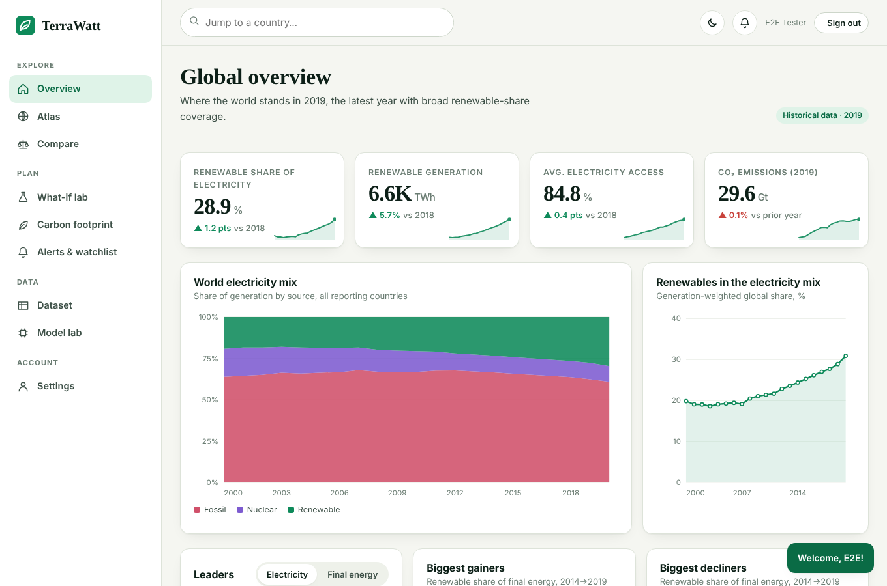
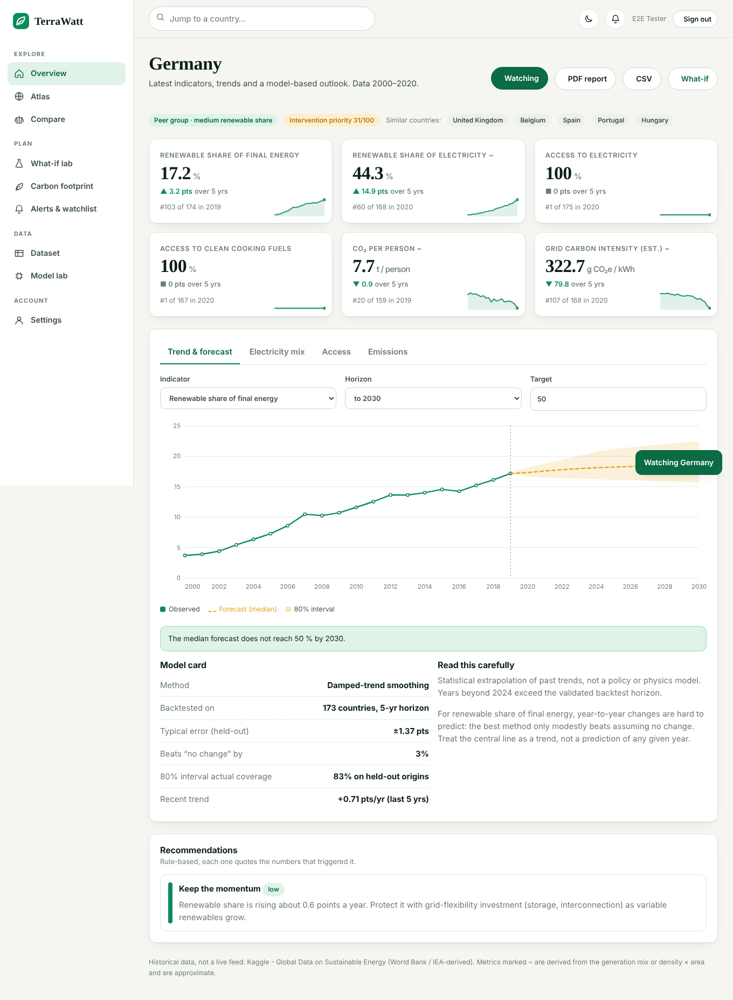
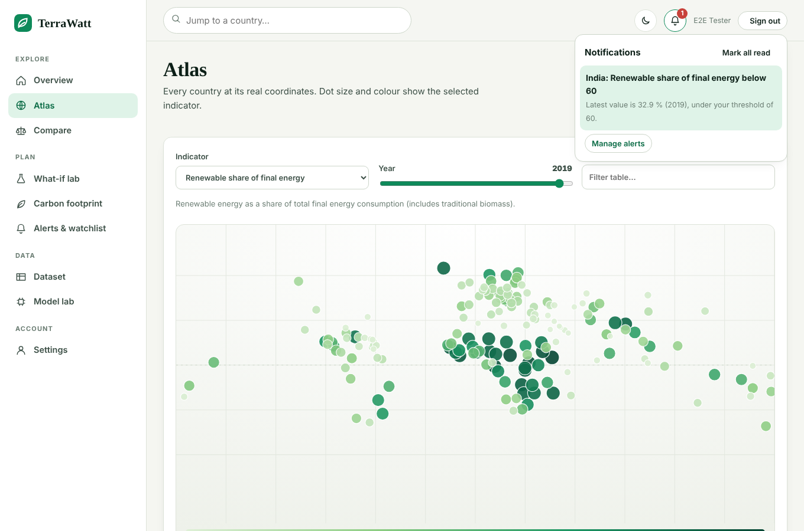
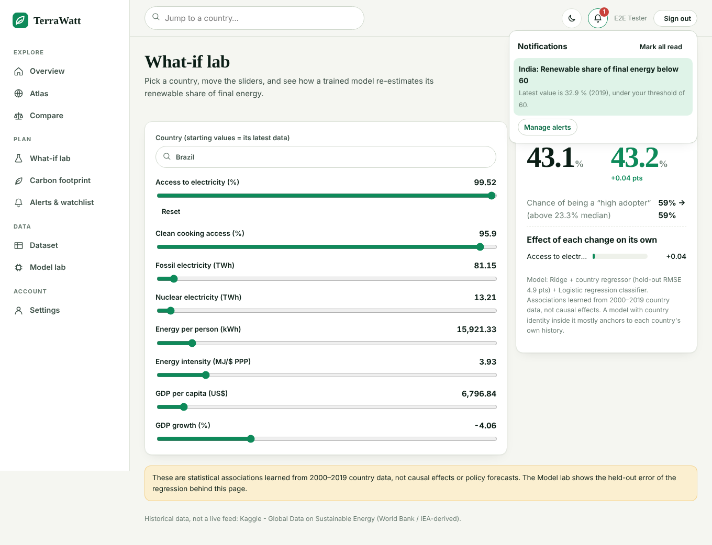
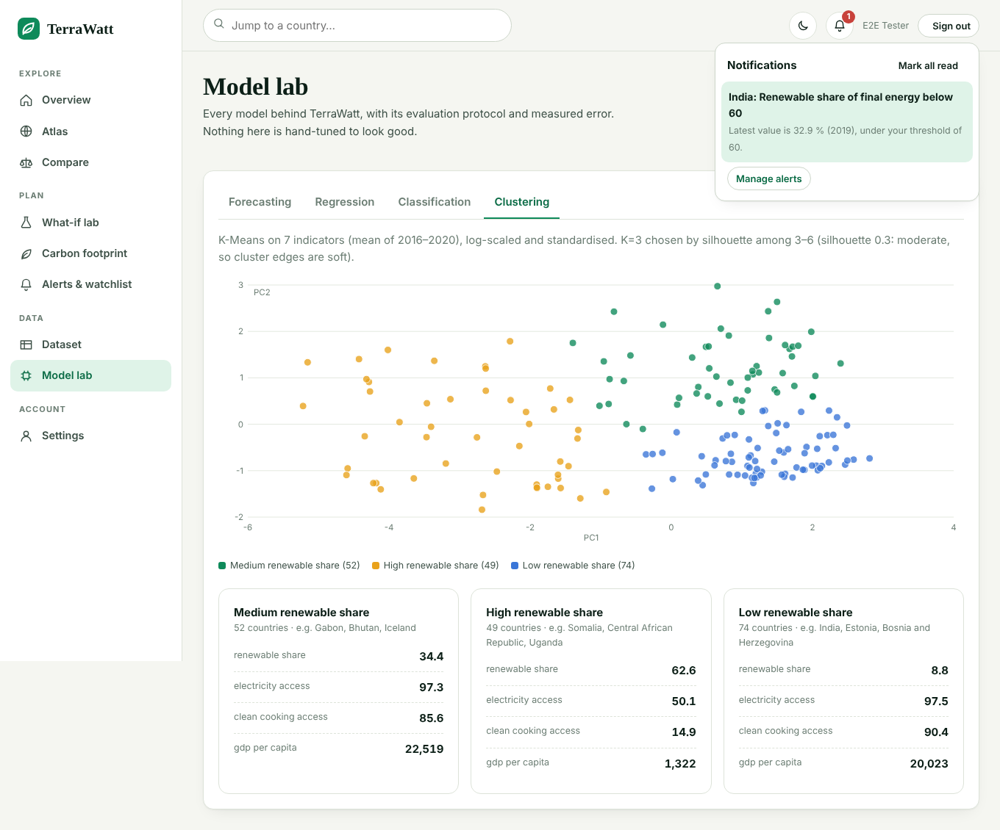
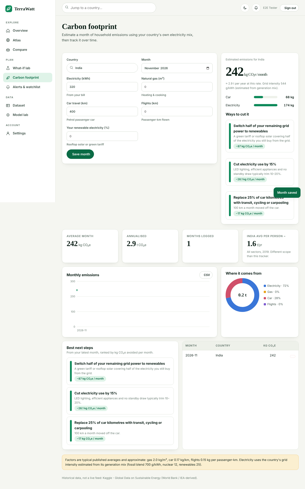
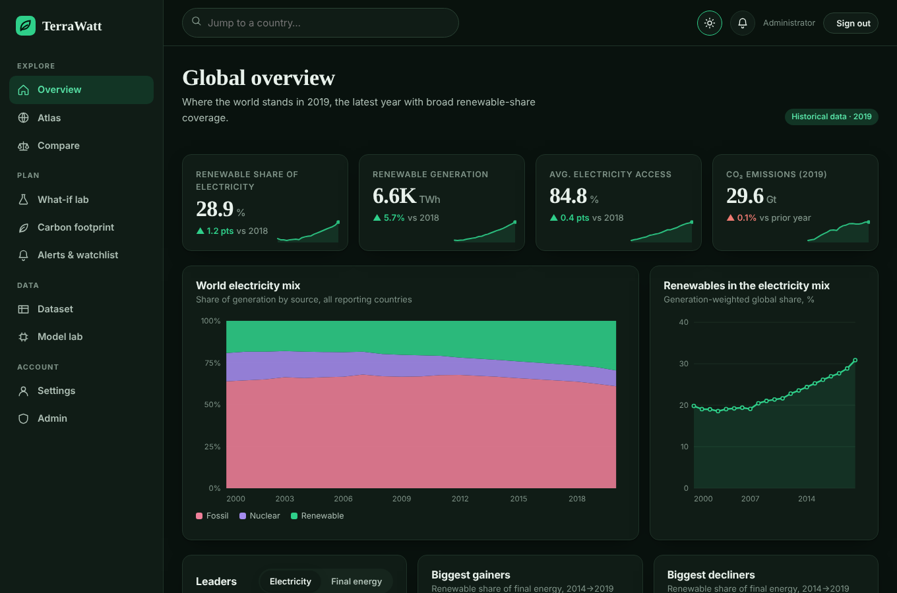
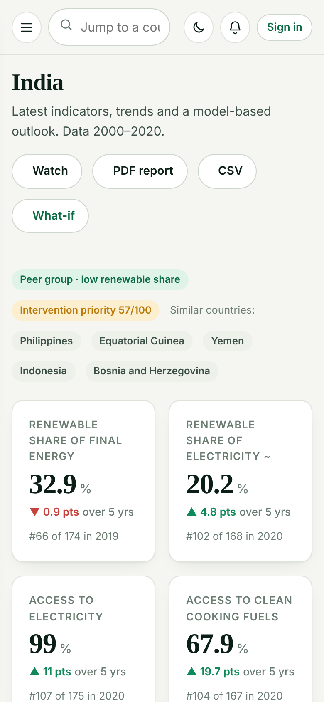

<div align="center">

# 🌿 TerraWatt

**Renewable-energy intelligence: explore 20 years of data for 176 countries, forecast the transition with honest error bars, and track your own carbon footprint.**

Flask · SQLite · scikit-learn · dependency-free SVG charts · JWT auth · 42 automated tests



</div>

> Formerly **GreenAI**, a Streamlit notebook-style ML project. Rebuilt as a multi-user full-stack product. The original research pipeline is preserved in [`research/`](research/).

## Why this exists

Energy-transition data is scattered across spreadsheets and PDFs, and most dashboards show a trend line with no sense of how reliable it is. TerraWatt answers three questions in one place: **where does each country stand, where is it heading (and how sure are we), and what can I do about my own emissions?**

## Features

| Area | What you get |
|---|---|
| **Global overview** | KPIs with year-on-year deltas, world electricity-mix area chart, leaders / biggest movers, personal watchlist |
| **Atlas** | Dot map of every country at its true coordinates, any of 13 indicators, year slider, sortable ranking table, CSV export |
| **Country profiles** | Ranks and percentiles, 5-year change, electricity mix, access, emissions, peer group (K-Means), rule-based recommendations that quote their evidence, PDF report + CSV |
| **Forecasting** | Projections to 2025-2040 with 80% intervals and a *model card* showing backtest error, skill vs "no change", and real interval coverage; optional target-year finder |
| **What-if lab** | Move GDP, electricity access, fossil generation… and see a trained model re-estimate renewable share, plus per-change effects |
| **Carbon footprint** | Public live calculator using the country's estimated grid mix; signed-in users save months, see trends/breakdown and ranked reduction actions with kg saved |
| **Alerts & watchlist** | Threshold, year-on-year-drop and *forecast-below-target* rules, de-duplicated notifications, bell menu |
| **Dataset explorer** | Server-side search / sort / paginate over all 3,649 rows |
| **Model lab** | Evaluation protocol, metrics, confusion matrix, importances and cluster profiles for every model |
| **Admin** | User management (role / disable), audit log, system health, model reload |
| **Platform** | Auth with scrypt + JWT in an HttpOnly cookie, CSRF header, login throttling, light/dark theme, responsive to phone width |

## Honesty about data and models

* **The data is historical, not live.** Source: Kaggle *Global Data on Sustainable Energy* (World Bank / IEA-derived), 2000-2020. Renewable share ends in **2019** (2020 coverage is ~1%). The UI labels this everywhere; nothing is simulated.
* **Derived metrics are marked `~`** (grid carbon intensity, CO₂ per person, renewable share of electricity). Grid intensity is estimated from the generation mix with IPCC-style lifecycle factors (fossil blend 700, nuclear 12, renewable 25 g/kWh), so coal-heavy grids are understated and gas-heavy grids overstated. Population is estimated as density × land area.
* **Forecasts are statistical extrapolation.** A rolling-origin backtest over 173 countries picks the method (damped-trend smoothing) using origins 2009-2014 and scores it on 2015-2018. Measured result for renewable share: held-out MAE **1.37 pts vs 1.42 for "no change" (only ~3% better)**; nominal 80% intervals cover **83%** of held-out forecasts. That is the honest ceiling for a slow, irregular series and the UI says so. Years beyond the 5-year validated horizon are flagged.
* **The what-if model is associative, not causal.** Best regressor (Ridge + country): held-out RMSE **4.9 pts**, R² 0.97 on 2016-2019. Without country identity (plain Ridge) R² falls to 0.73, because a country's own history dominates. Classifier (above-median adopter): F1 0.80, ROC-AUC 0.92 on **unseen countries**.
* Carbon-tracker factors (gas 2.0 kg/m³, car 0.17 kg/km, flights 0.15 kg/pkm) are typical published averages, approximate.

## Screenshots

| Country forecast & model card | Atlas |
|---|---|
|  |  |
| **What-if lab** | **Model lab** |
|  |  |
| **Carbon tracker** | **Dark mode / mobile** |
|  |   |

## Quick start

```bash
git clone <your-repo-url> terrawatt && cd terrawatt
python -m venv .venv && source .venv/bin/activate        # Windows: .venv\Scripts\activate
pip install -r requirements.txt
cp .env.example .env                                     # optional in development
python run.py                                            # trains models on first run (~20 s), then serves
# open http://127.0.0.1:5000
```

Create an admin: `python -m backend.manage create-admin --email you@example.com --password 'Str0ngPass1'` (or set `ADMIN_EMAIL` / `ADMIN_PASSWORD` in `.env`).
Tests: `pip install -r requirements-dev.txt && pytest` · browser journey test: start the server, then `python tests/e2e_smoke.py`.

### Environment variables
See [`.env.example`](.env.example). Key ones: `SECRET_KEY` (**required** when `TERRAWATT_ENV=production`), `DATABASE_PATH`, `JWT_TTL_HOURS`, `COOKIE_SECURE`, `LOGIN_MAX_ATTEMPTS`, `ADMIN_EMAIL/PASSWORD`.

## Architecture

```
Browser (vanilla ES-module SPA, hash router, custom SVG charts)
   │  JSON over HTTPS, HttpOnly JWT cookie + X-Requested-With CSRF header
Flask app factory ── routes/ (auth, energy, ml, footprint, alerts, exports, admin)
   │                     pydantic schemas validate every body; uniform error envelope
   ├─ services/  data_service (pandas, derived metrics) · forecast (backtested NumPy) · predictor
   │             carbon · alerts · recommendations · reports (ReportLab PDF)
   ├─ ml/        train.py (leakage-safe protocols) → models/*.joblib + model_cards.json
   └─ SQLite (WAL, FK on): users, footprint_entries, watchlist, alert_rules, notifications, audit_log
```

Design decisions worth discussing in an interview:

* **No build step, no chart library.** The frontend is ES modules plus ~300 lines of SVG chart code, themeable through CSS variables, so the app runs with `python run.py` and a strict `script-src 'self'` CSP.
* **Backtest-driven forecasting.** Methods compete on held-out origins; selection and interval calibration use earlier origins than the reported scores. Intervals are scaled by each country's own volatility.
* **Leakage-safe ML.** Chronological split for regression; country-grouped split and `StratifiedGroupKFold` for classification; thresholds from the training median; direct renewable indicators excluded from features.
* **Security.** scrypt hashes, JWT re-validated against the DB each request (disabling a user is immediate), `extra="forbid"` schemas block mass-assignment, parameterised SQL only, per-app login throttle, ownership checks on every user-scoped query, CSP and security headers.
* **Single-process limits.** The login throttle and forecast cache are in-memory; use Redis and several workers when scaling (see Future scope).

More detail: [`docs/ARCHITECTURE.md`](docs/ARCHITECTURE.md) · API: [`docs/API.md`](docs/API.md)

## Project structure

```
backend/app/{routes,services,ml}   API, domain logic, training
backend/manage.py                  CLI: train, create-admin
frontend/{css,js,js/pages}         SPA
data/  models/  instance/          dataset · trained artefacts · SQLite (git-ignored)
tests/                             42 pytest tests + Playwright journey test
research/                          original GreenAI academic pipeline, reports, plots
```

## Testing status

* `pytest`: 42 tests (auth, CSRF, throttling, authorisation, validation, data sanity vs public magnitudes, forecast invariants, backtest leakage guard, carbon maths, alerts de-duplication, per-user isolation, exports).
* `tests/e2e_smoke.py`: headless Chromium walks register → watch → forecast → PDF download → carbon save/delete → alerts → what-if → admin → dark mode → phone viewport with zero console errors or horizontal overflow.
* **Not verified here:** the `Dockerfile` (no Docker in the build environment) and live deployment behind HTTPS.

## Future scope

Real-time grid feeds (e.g. Open-Meteo irradiance / wind, ElectricityMaps) behind an adapter with caching; solar vs wind breakdown (not in this dataset); country polygons for a choropleth; Redis-backed throttle and cache; Alembic migrations / Postgres; scheduled alert evaluation with email; scenario-based projections from policy targets; i18n.

## Data credit & licence

Dataset: [Kaggle - Global Data on Sustainable Energy](https://www.kaggle.com/datasets/anshtanwar/global-data-on-sustainable-energy), subject to its own licence. Code: MIT.
